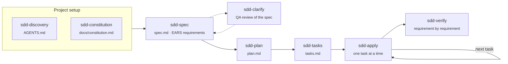

<p align="center">
  
</p>

<h3 align="center">Fourteen agents, two skills and a memory for the AI assistants you already use.</h3>

<p align="center">
  Spec-Driven Development and Android agents, installed natively into OpenCode and Claude Code<br>
  from a single source, with one binary and one menu.
</p>

<p align="center">
  <a href="https://github.com/iesedobleac/iesedoble-ai/actions/workflows/ci.yml"></a>
  <a href="https://github.com/iesedobleac/iesedoble-ai/releases/latest"></a>
  
  <a href="LICENSE"></a>
</p>

<p align="center">
  <a href="#-quick-start">Quick start</a> ·
  <a href="#-what-you-get">What you get</a> ·
  <a href="#-the-agents">The agents</a> ·
  <a href="#-command-line">Command line</a> ·
  <a href="#-how-it-treats-your-machine">Your machine</a> ·
  <a href="#-development">Development</a>
</p>

---

## ⚡ Quick start

```bash
brew install --cask iesedobleac/tap/iesedoble-ai
iesedoble-ai
```

Pick your assistants, the components and a model per role, review, install. That's it.

📖 **[Install and usage guide](docs/install-and-usage.md)**: prerequisites, first run, using the
agents, updating, uninstalling and troubleshooting.

<details>
<summary><b>Other ways to install</b> (script, Windows, from source)</summary>

<br>

**macOS / Linux script**: uses Homebrew on macOS when it is there; otherwise downloads the
binary from GitHub Releases and verifies its checksum.

```bash
curl -fsSL https://raw.githubusercontent.com/iesedobleac/iesedoble-ai/main/scripts/install.sh | bash
```

**Windows (PowerShell)**: checks git and Go, then builds and installs with `go install`.

```powershell
irm https://raw.githubusercontent.com/iesedobleac/iesedoble-ai/main/scripts/install.ps1 | iex
```

**From source** (Go 1.26+)

```bash
go install github.com/iesedobleac/iesedoble-ai/cmd/iesedoble-ai@latest
```

</details>

## ✨ Why

- **One source, native output.** Each agent is written once. The installer renders it in each
  assistant's own format: OpenCode agents with per-agent permissions, Claude Code subagents with
  tool lists.
- **Your models, not ours.** It lists the models your assistant actually offers (OpenCode's from
  your connected providers) and lets you choose one per role. Nothing is preselected that you
  cannot run.
- **Safe to run again.** Files you edited are backed up before they are replaced, your own
  configuration is left alone, and `uninstall` removes exactly what was added.
- **It configures, it doesn't take over.** It never installs an assistant or Node.js for you. It
  checks what your selection needs and tells you, before writing a single file.

## 🖥 A look inside

<table>
  <tr>
    <td width="50%"></td>
    <td width="50%"></td>
  </tr>
  <tr>
    <td align="center"><b>Persona</b>: how your assistant talks to you, explained option by option</td>
    <td align="center"><b>Models</b>: one per role, with a guide to what each role needs</td>
  </tr>
  <tr>
    <td width="50%"></td>
    <td width="50%"></td>
  </tr>
  <tr>
    <td align="center"><b>Review</b>: everything that will be installed, at a glance</td>
    <td align="center"><b>Install</b>: every step, with progress</td>
  </tr>
</table>

## 🧩 Supported assistants

| Assistant | Status | Installs into |
|---|---|---|
| **OpenCode** | ✅ Supported | `~/.config/opencode` |
| **Claude Code** | ✅ Supported | `~/.claude` (or `$CLAUDE_CONFIG_DIR`) |

## 📦 What you get

| | OpenCode | Claude Code |
|---|---|---|
| 🤖 **Agents** | 15 agents with per-agent permissions; orchestrators are primary agents | 15 subagents with tool lists; run an orchestrator with `claude --agent <name>` |
| 📚 **Skills** | `sdd-workflow`, `skill-generator` | Same |
| 📏 **Rules** | Managed block in `AGENTS.md` | Managed block in `CLAUDE.md` |
| 🛡 **Safety** | Per-agent shell rules | Session deny rules for `git push`, `git reset --hard`, `git clean`, `git rebase`; optional sandbox for shell commands |
| 🧠 **Memory** | [Engram](https://github.com/Gentleman-Programming/engram) MCP + `engram setup opencode` | Engram MCP + `engram setup claude-code` |
| 🕸 **Code graph** | [CodeGraph](https://www.npmjs.com/package/@colbymchenry/codegraph) MCP | Same |
| 🔔 **Plugin** | Context warning: past 200k tokens of context (then every +100k), offers to compact now or continue in a new session | Not needed |
| 🎭 **Persona** | Optional, added once to `AGENTS.md`: **Architect** (verifies before agreeing, challenges with evidence) or none, plus the **Concise** style that cuts output tokens | Same, in `CLAUDE.md` |

Every component can be switched off in the menu or with `--without`.

The **Settings** step adjusts how each assistant behaves:

- **Claude Code sandbox** (`--with claude-sandbox`, off by default) turns on Claude Code's
  [sandbox](https://code.claude.com/docs/en/sandboxing): shell commands can only write inside the
  project and have no network, so Claude Code runs them without asking. `adb` and `./gradlew` run
  outside it and ask as usual, and the deliverables folder stays writable. It needs macOS, Linux
  or WSL2; on Linux, install `bubblewrap` and `socat`.
- **Claude Code auto-compact** (`--claude-autocompact`) sets how many tokens of context Claude
  Code allows before it compacts on its own; by default, Claude Code's own window.
- **OpenCode subagent monitor** (`--with subagent-monitor`, off by default) keeps the subagent
  statusline that Engram's setup adds; off, the installer removes it from `tui.json` and
  `cli.json`.

## 🤖 The agents

### Spec-Driven Development

`sdd-orchestrator` coordinates the flow and delegates each phase to its own agent. Phases run
when you ask for them, and nothing is saved without your approval.



### Android

`android-orchestrator` handles small and medium Android tasks without SDD phases. Its five
subagents also serve the SDD flow.

| Agent | Role |
|---|---|
| `android-explore` | Read-only explorer: maps files, symbols and impact, CodeGraph first |
| `android-research` | Answers documentation questions from the web with verbatim quotes and URLs |
| `android-worker` | Implements closed, already-designed tasks within the allowed files |
| `android-review` | Reviews a diff against its task and the project style; never edits |
| `android-device` | Installs builds and drives `adb`, screenshots, logcat and perfetto |

### Model roles

Each agent runs on the model of its role. The roles follow one idea: spend where a mistake
compounds, save where the work is mechanical.

| Role | Used by | What suits it | Claude Code default |
|---|---|---|---|
| **planner** | Orchestrators, `sdd-spec`, `sdd-clarify`, `sdd-plan` | Your strongest model, high effort: a bad plan compounds | `opus` · high |
| **analyst** | `sdd-discovery`, `sdd-constitution`, `sdd-tasks`, `android-research` | A balanced model, medium effort | `sonnet` · medium |
| **executor** | `android-worker`, `sdd-apply` | A balanced model, low effort: the thinking happened in the plan | `sonnet` · low |
| **scout** | `android-explore`, `android-device` | Your fastest, cheapest model, low effort | `haiku` · low |
| **reviewer** | `android-review`, `sdd-verify` | A strong model, ideally of another family than the executor | `opus` · medium |

The menu explains each role as you choose, but the choice is yours. In Claude Code each agent
also gets the role's effort (`auto` keeps your session's); in OpenCode, add a variant to the
model ID when the model offers one (`provider/model#high`).

In the menu each role gets a model from the list your assistant offers: OpenCode's come from
`opencode models` (only the providers you have connected); Claude Code's are `opus`, `sonnet`,
`haiku`, `fable` and `inherit`. **Custom…** takes any other ID, such as a full Claude model ID.

Only `android-review` and `sdd-verify` have a step limit: with Claude models through GitHub
Copilot in OpenCode, reaching one fails with "does not support assistant message prefill".

## ⌨️ Command line

The menu covers everything; the same options work without it.

```bash
iesedoble-ai install --targets opencode,claude --dry-run   # see what would change
iesedoble-ai install --without android --claude-planner sonnet
iesedoble-ai sync        # re-apply the last selection, e.g. after upgrading
iesedoble-ai doctor      # read-only health check
iesedoble-ai uninstall   # remove everything it installed
```

<details>
<summary><b>All install flags</b></summary>

<br>

| Flag | Effect |
|---|---|
| `--targets` | `opencode`, `claude` (default: the ones found on this machine) |
| `--without` | Skip components: `sdd`, `android`, `skills`, `plugin`, `engram`, `codegraph` |
| `--with` | Add components that are off by default: `subagent-monitor`, `claude-sandbox` |
| `--persona` | `architect` (default) or `none` |
| `--concise` | Caveman-style concise replies (default on; `--concise=false` to skip) |
| `--planner`, `--analyst`, `--executor`, `--scout`, `--reviewer` | OpenCode model per role |
| `--claude-planner`, `--claude-analyst`, … `--claude-reviewer` | Claude Code model per role |
| `--claude-planner-effort`, … `--claude-reviewer-effort` | Claude Code effort per role: `auto`, `low`, `medium`, `high`, `xhigh`, `max` |
| `--claude-autocompact` | Claude Code auto-compact window in tokens, `100000` to `1000000` (default: Claude Code's own) |
| `--config-dir`, `--claude-dir` | Assistant config directories |
| `--deliverables-dir`, `--android-sdk` | Paths the agents use |
| `--skip-deps`, `--no-shell-profile`, `--dry-run` | Behaviour |

A model the assistant does not list produces a warning, and the install goes on.

</details>

<details>
<summary><b>What it checks before installing</b></summary>

<br>

| Tool | Needed when | If it is missing |
|---|---|---|
| git | Always | The install stops |
| OpenCode | OpenCode selected | The install stops; get it from [opencode.ai](https://opencode.ai/docs) |
| Claude Code | Claude Code selected | Its configuration is prepared anyway |
| Node.js 18+ and npm | CodeGraph selected | A warning with the install command for your platform |
| Engram | Engram selected | Installed for you (Homebrew, or its GitHub release) |
| CodeGraph | CodeGraph selected | Installed for you with npm |

</details>

## 🏠 How it treats your machine

- 💾 **Backups.** A file you edited is copied to `~/.iesedoble-ai/backups/<date>/` before it is
  replaced.
- 🤝 **Your configuration stays.** MCP servers with the same name are left untouched, rules go in a
  marked block, and deny rules are only ever added.
- 📝 **State.** `~/.iesedoble-ai/state.json` records what was installed and your selection;
  `sync` reuses it and `uninstall` removes what it lists.
- 🧾 **Logs.** Every install, sync and uninstall leaves a log in `~/.iesedoble-ai/logs/` (the
  last 20 are kept).
- 💸 **Save tokens.** Short sessions, `/compact` and lower effort for simple tasks save more than any
  setting; see [Save tokens day to day](docs/install-and-usage.md#save-tokens-day-to-day).
- ⚠️ **`opencode.jsonc` comments are lost.** The file is rewritten as plain JSON, after a backup.

## 🛠 Development

```bash
go test ./...
go run ./cmd/iesedoble-ai install --dry-run
```

<details>
<summary><b>How the code is organised</b></summary>

<br>

**`assets/`** is the single source, embedded in the binary.

| Path | Contents |
|---|---|
| `assets/agents/<name>.json` | Description, mode, model role, step limit and ordered permission rules |
| `assets/agents/<name>.md` | The prompt |
| `assets/skills/`, `assets/rules/rules.md` | Skills and the rules block |
| `assets/mcp.json`, `assets/plugins/opencode/` | MCP catalog and OpenCode plugins |

Prompts, skills and rules are templates:

- `{{read}}`, `{{grep}}`, `{{edit}}`, `{{webfetch}}` and similar tokens become each assistant's
  tool names.
- `{{#opencode}}…{{/opencode}}` and `{{#other}}…{{/other}}` hold text for OpenCode or for every
  other assistant.
- `@@PLACEHOLDERS@@` are machine paths resolved at install time.

**`internal/render`** defines the tokens and each assistant's file format.

**`internal/installer`** has one adapter per assistant (`opencode.go`, `claude.go`) behind the
`Target` interface in `target.go`: detection, paths, requirements, models, install and uninstall.
Adding an assistant means a new adapter and one entry in the `targets` list; its menu entry,
flags and progress steps follow.

**`internal/tui`** is the interactive menu.

</details>

<details>
<summary><b>Releasing</b></summary>

<br>

Push a `v*` tag. GoReleaser builds the macOS and Linux binaries, publishes them with
`checksums.txt`, and updates the cask in
[`iesedobleac/homebrew-tap`](https://github.com/iesedobleac/homebrew-tap) (secret
`HOMEBREW_TAP_GITHUB_TOKEN`).

</details>

## 📄 License

[MIT](LICENSE). The Concise style is adapted from
[caveman](https://github.com/juliusbrussee/caveman) (Apache-2.0).
